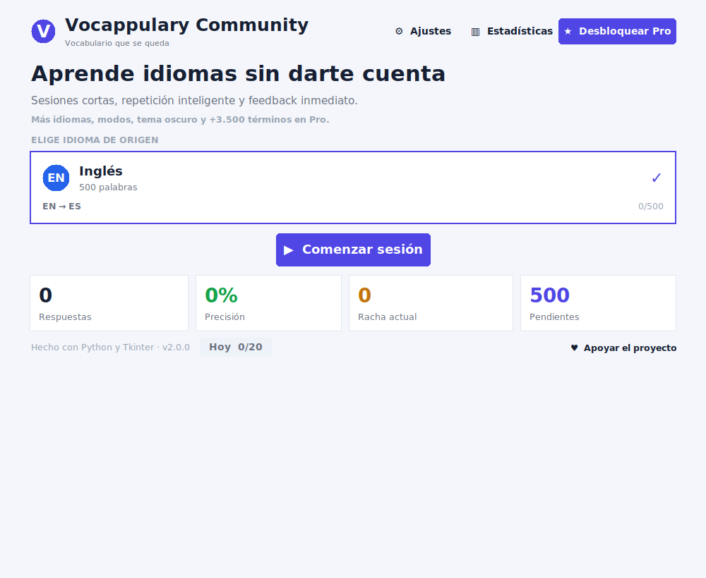
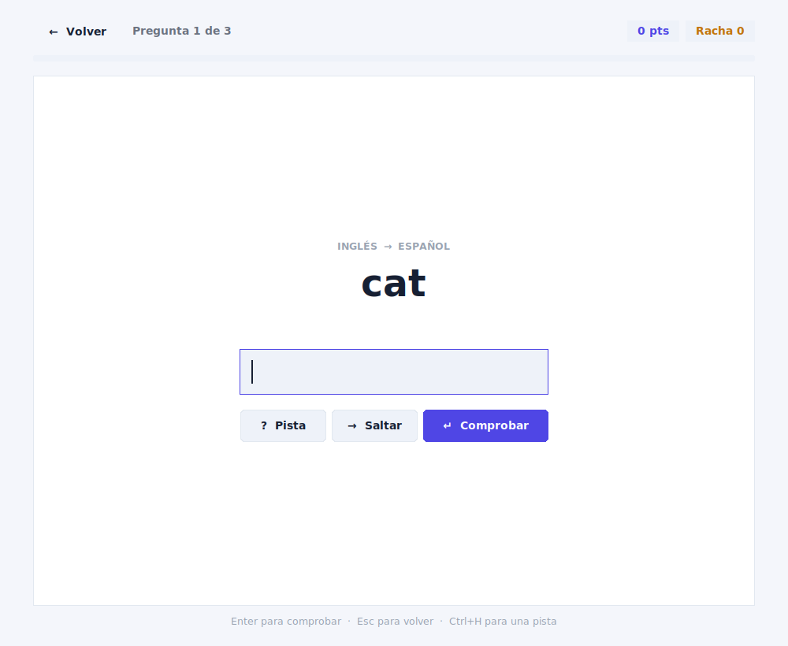
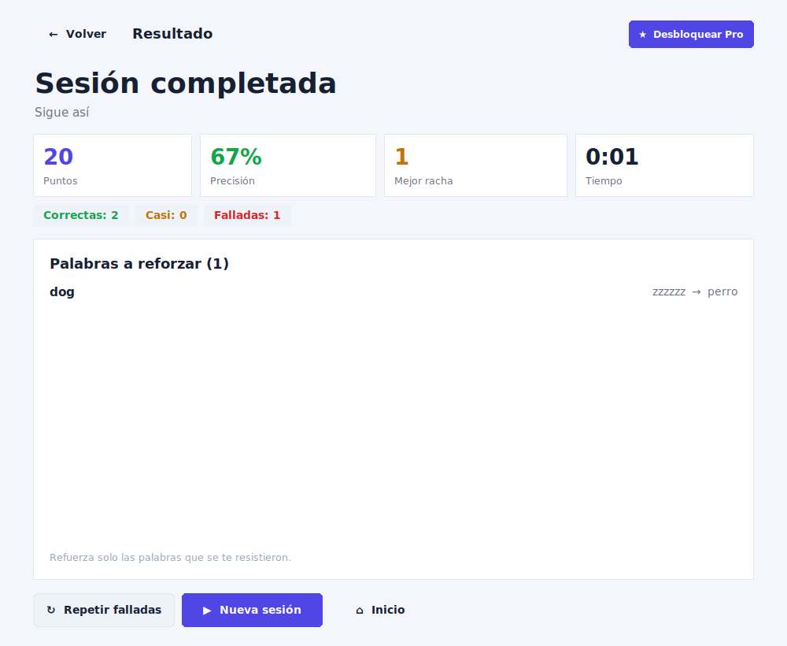
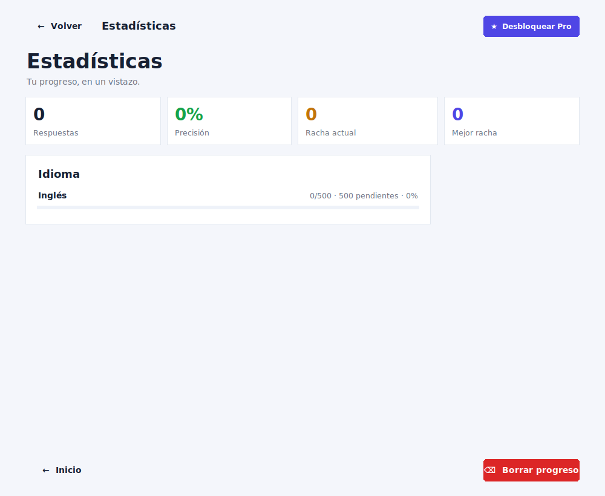
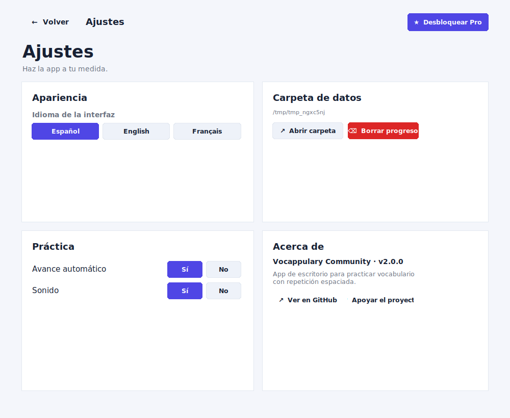

# Vocappulary Community

Edición gratuita y open source.
<!-- GitHub topics: vocabulary, language-learning, python, tkinter, open-source, education -->

App de escritorio para **practicar vocabulario** en inglés ↔ español, con repetición espaciada y una interfaz moderna.

<p align="center">
  
</p>

<p align="center">
  
  
</p>

<p align="center">
  
  
</p>

**500 términos** en inglés, una palabra y una traducción por entrada.

## Qué incluye

- **Inglés → Español** con 500 palabras de uso frecuente.
- **Validación exacta**: mayúsculas y espacios; sin tildes, plurales, artículos ni erratas. Las alternativas separadas por `/` siguen valiendo si coinciden exactamente.
- **Repetición espaciada** tipo Leitner: las palabras difíciles vuelven antes; las aprendidas descansan.
- **Modo de práctica**: aprender.
- **Vocabulario base**: animales, comida, viajes, trabajo, tecnología, emociones, naturaleza, salud, ropa, deporte, música, educación, personas, etc.
- **Estadísticas básicas**: respuestas, precisión y racha actual.
- **Resultados de sesión** con opción de repetir solo las falladas.
- **Tema claro**; interfaz en español, inglés y francés.
- **Botón Desbloquear Pro** siempre visible en la cabecera.
- **Atajos de teclado**: `Enter` comprobar/continuar, `Esc` volver, `Ctrl+H` pista.
- **Datos guardados** en la carpeta de usuario, no en la carpeta de la app.

## Cómo funciona

1. Pulsa **Comenzar sesión**.
2. Escribe la traducción y pulsa **Enter** o **Comprobar**.
3. La app indica si la respuesta es correcta, casi correcta o incorrecta y muestra la respuesta válida.
4. Al terminar verás el resumen y podrás repetir las palabras falladas.

### Feedback

- ✅ **Correcto**: coincide exactamente con una traducción válida.
- ❌ **Incorrecto**: se muestra la respuesta correcta.

## Para usuarios

[Descarga el ZIP](https://github.com/agarnung/vocappulary-community/releases/latest), descomprímelo donde quieras y ejecuta el **.exe** (Windows) o el binario correspondiente. También puedes crear un acceso directo en el escritorio.

El progreso se guarda en:

- **Windows**: `%APPDATA%\Vocappulary`
- **macOS**: `~/Library/Application Support/Vocappulary`
- **Linux**: `~/.local/share/vocappulary`

## Ediciones

Este repositorio es la **edición Community**: código abierto, gratuito y en evolución. La versión antigua v1.0 se conserva como **beta open source** en las releases.

| | Community (este repo) | Pro (binario) |
|---|---|---|
| Código fuente | Sí, abierto | No |
| Precio | Gratis | Pago único |
| Idiomas | EN → ES | EN/FR/IT ↔ ES |
| Términos | 500 | +3.500 |
| Corrección | Exacta | Tolerante |
| Modos | Aprender | Aprender/repasar/rápida |
| Sesión | 10 | 10/20/50/todas |
| Estadísticas | Básicas | Completas |
| Tema oscuro | No | Sí |
| Packs | No | Extras |
| Instalación | Manual | Binario firmado |
| Actualizaciones | Manuales | Incluidas |
| Soporte | Comunidad | Prioritario |

## Vocappulary Pro

Vocappulary Community muestra un botón **Desbloquear Pro** en la cabecera. La versión Pro añade:

- **EN/FR/IT ↔ ES** y **+3.500 términos**.
- Todos los modos: aprender, repasar y rápida.
- Sesiones de 10/20/50/todas las palabras.
- Tema oscuro, estadísticas completas y validación tolerante.
- Sin anuncios.

**Comprar la versión Pro:** [Vocappulary Pro](TU_URL_DE_COMPRA)

> **TODO:** sustituye `TU_URL_DE_COMPRA` por tu enlace de pago (**Polar** recomendado; Paddle o Gumroad como alternativas) y cambia `PRO_URL` en `vocapp/config.py` o la variable `VOCAPP_PRO_URL` para que el botón abra directamente el checkout.

## Para desarrolladores

### Requisitos

- Python 3.10 o superior
- Tkinter (incluido con Python)
- Para empaquetar: `pip install -r requirements.txt`

La app **no necesita dependencias externas en tiempo de ejecución**.

### Ejecutar localmente

```bash
python3 -m venv vocappulary_venv
source vocappulary_venv/bin/activate  # Linux / macOS
# .\vocappulary_venv\Scripts\Activate.ps1  # Windows PowerShell
pip install -r requirements.txt
python3 main.py
```

### Tests

```bash
python3 -m unittest discover -s tests -v
python3 utils/validate_vocab.py
```

### Generar ejecutable de escritorio

Linux / macOS:

```bash
pyinstaller --noconfirm --clean VocappularyCommunity.spec
```

Windows (PowerShell):

```powershell
pyinstaller --noconfirm --clean VocappularyCommunity.spec
```

El ejecutable se genera en `dist/`. Los datos de vocabulario van dentro del ejecutable; el progreso del usuario se guarda aparte en la carpeta de datos.

### Estructura

```text
main.py                 Punto de entrada
vocapp/
  app.py                Ventana principal y navegación
  screens.py            Pantallas: inicio, juego, resultados, estadísticas, ajustes
  widgets.py            Botones redondeados, tarjetas, barras, campos, segmentados
  theme.py              Paletas claro/oscuro y tipografía
  i18n.py               Traducciones de la interfaz (es/en/fr)
  vocab.py              Carga, normalización y categorías de vocabulario
  validation.py         Validación de respuestas
  session.py            Lógica de una sesión
  storage.py            Ajustes, estadísticas, SRS y persistencia
  data/                 Registro de idiomas, categorías y packs
palabras_en.json       Diccionario base inglés → español
VocappularyCommunity.spec  Receta de PyInstaller
utils/                  Utilidades de mantenimiento de vocabulario
tests/                  Tests del núcleo y de los datos
```

## Añadir idiomas

El registro está en `vocapp/data/languages.json`. **Community solo incluye `en`**; la edición Pro añade `fr` e `it`:

```json
{
  "en": {
    "name": { "es": "Inglés", "en": "English", "fr": "Anglais" },
    "label": "EN",
    "color": "#2563EB",
    "files": ["palabras_en.json"],
    "categories": "categories_en.json"
  }
}
```

Para añadir otro idioma en una edición propia, crea su pack con el formato de abajo y añádelo a `files`. La app detecta el idioma automáticamente y lo muestra en el inicio.

## Añadir o ampliar vocabulario

Un pack puede ser un JSON plano:

```json
{
  "kitten": ["gatito", "minino"],
  "puppy": ["cachorro"]
}
```

O un pack enriquecido con categorías y nombres localizados:

```json
{
  "meta": { "name": { "es": "Animales", "en": "Animals" } },
  "category_names": {
    "animals": { "es": "Animales", "en": "Animals", "fr": "Animaux" }
  },
  "categories": {
    "kitten": "animals",
    "puppy": "animals"
  },
  "words": {
    "kitten": ["gatito", "minino"],
    "puppy": ["cachorro"]
  }
}
```

Añade el archivo a `files` del idioma en `languages.json`. Las claves repetidas se fusionan y las traducciones se deduplican automáticamente.

Los packs incluidos están en `vocapp/data/packs/`.

## Versión móvil

El núcleo (`vocab.py`, `validation.py`, `session.py`, `storage.py`) no depende de Tkinter. Para publicar en Android/iOS:

1. Reutiliza esos módulos sin cambios.
2. Crea una UI con **Flet**, **Kivy** o **BeeWare**.
3. Empaqueta con `flet build apk` / `buildozer android debug` / Briefcase.
4. La monetización y la licencia se gestionan en la edición Pro privada.

La versión web puede hacerse con Flet o Streamlit reutilizando el mismo núcleo.

## Utils incluidos

### Validar vocabulario

```bash
python3 utils/validate_vocab.py
```

Comprueba tipos, traducciones vacías, duplicados y cobertura de categorías.

### Eliminar palabras repetidas

```bash
python3 utils/remove_repeated_words.py ruta_del_json.json
```

### Traducir vocabulario automáticamente

```bash
pip install -r requirements-utils.txt
python3 utils/translate_json.py [en-fr|fr-en] ruta_del_json.json
```

## Troubleshooting

- Si hay problemas de red en WSL al instalar librerías, añade `nameserver 8.8.8.8` a `/etc/resolv.conf`.
- Si el ejecutable no encuentra los diccionarios, comprueba que los `--add-data` apunten a `vocapp/data` y a los JSON de la raíz.
- En Linux sin entorno gráfico, Tkinter necesita un servidor X o Wayland con XWayland.

## Licencia

MIT. Ver [LICENSE](LICENSE).

## TODO

Ver [TODO.md](TODO.md).
